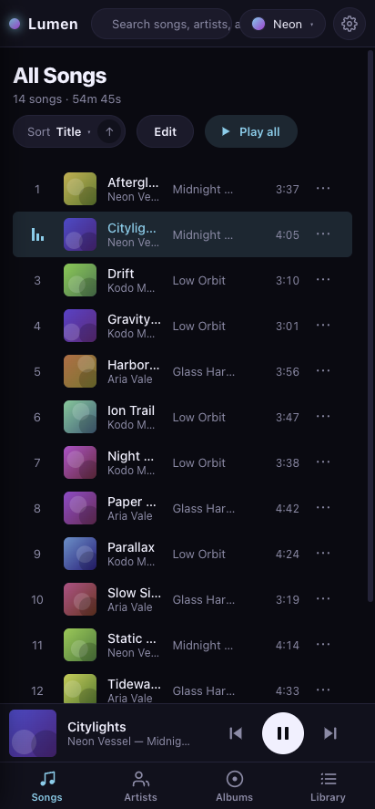
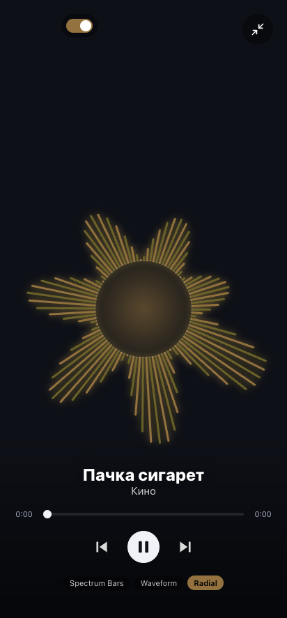
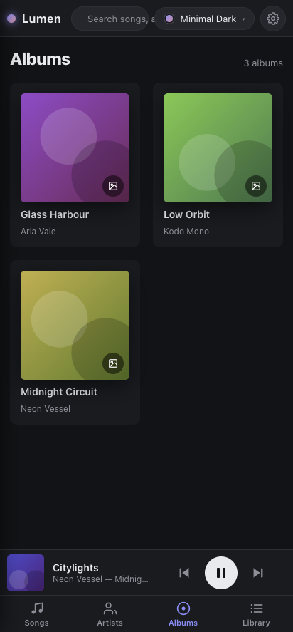
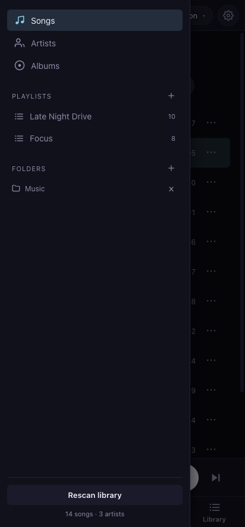
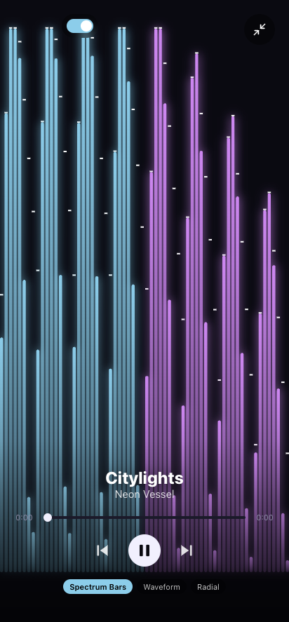
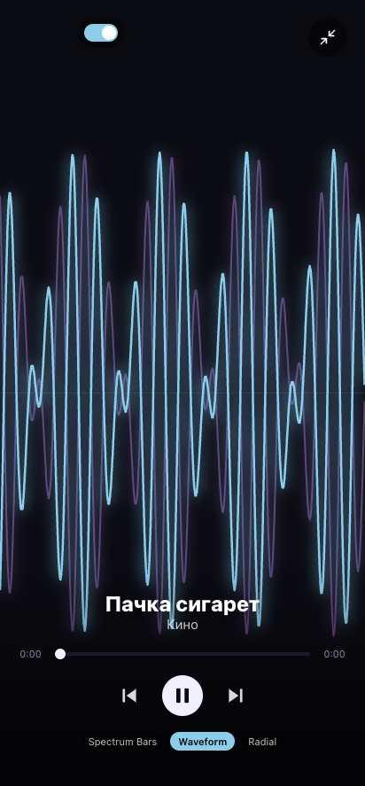
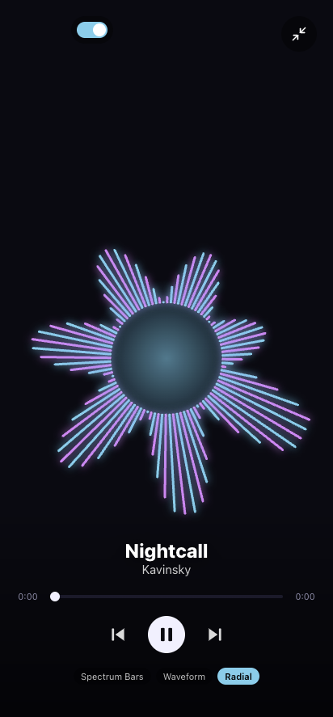

# Lumen for Android

This is the Android version of [Lumen](https://github.com/wumgub/lumen-player), my
music player with the reactive visualizers. It's the same React interface as the
desktop app, wrapped in a WebView with [Capacitor](https://capacitorjs.com/) and
built into a normal sideloadable `.apk`.

It's meant for Android 12 and up, where the system WebView is recent enough to run
everything. It isn't built for old phones; we now have [Lumen Ultralight](https://github.com/wumgub/lumen-ultralight) for that!

## Screenshots

<p>
  
  
  
  
</p>

## Visualizers

There are three. Tap the mini-player to go full screen, then switch between them
from the row at the bottom.

<p>
  
  
  
</p>

Left to right: Spectrum Bars, Waveform, Radial. They take their colours from
whatever theme you're using.

## Installing

Grab the latest `Lumen-*.apk` from the [releases page](https://github.com/wumgub/lumen-android/releases/latest)
and open it on the phone. Android will warn you about installing an app from
outside the Play Store, and since it isn't signed with a paid developer
certificate you might get an extra "unknown app" prompt too. Both are normal for a
sideloaded build, so allow it and you're in. From there, add some music and pick
your audio files.

## What it needs

The player part is cheap to run. The visualizer is the only hungry piece, since it
keeps a Web Audio analyser and a canvas animation going the whole time it's on. So
the rough guidance is:

- Android 12 or newer
- around 3 GB of RAM (4 GB or more is comfortable)
- a mid-range chip from roughly 2019 onward
- free space about equal to the music you plan to import, plus a bit

That last point is worth knowing: importing copies each track into the app's own
storage instead of reading it where it sits, so your library takes up real space.
A later MediaStore-based library will read files in place and drop that cost.

If a phone struggles, turn the visualizer off from the now-playing screen, or drop
it to 30 or 15 FPS in settings. Browsing and playback stay light either way.

## What's different from the desktop app

The desktop version leans on a Node process for the library, file scanning, and
Discord presence. None of that exists inside a WebView, so the Android build
rebuilds those parts on web APIs instead:

| Desktop | Android |
| --- | --- |
| SQLite library | IndexedDB, stored on the device |
| Filesystem folder scan | pick tracks through Android's file picker |
| music-metadata (Node) | music-metadata's browser build, reading tags and art in the app |
| `lumen-media://` / `lumen-art://` | `blob:` URLs built from the imported files |
| Discord Rich Presence | not available |
| tag edits written to files | kept as in-app overrides; your files aren't touched |

A few things to know about this early version:

- You add music by picking files, not by pointing at a folder that keeps itself up
  to date. A proper MediaStore library (browse by folder, pick up new music on its
  own) is the next thing I want to build.
- The visualizer runs continuously, so it isn't a battery-saver. It's fine on a
  modern phone.
- If the interface looks broken on a custom ROM, the WebView is probably old.
  Updating "Android System WebView" from the Play Store or F-Droid fixes it.

## Building it

You don't need a local Android SDK. Pushing a version tag builds the APK in GitHub
Actions and attaches it to the release:

```bash
git tag v0.1.0
git push --follow-tags
```

You can also run the workflow by hand from the Actions tab to get an APK without
cutting a release.

To work on the interface without a phone:

```bash
npm install
npm run dev
```

The same web backend runs in a desktop browser, so you can build the whole thing
there. `npm run build` produces the `dist/` bundle Capacitor ships.

## License

GPL-3.0-or-later, same as the desktop app.
